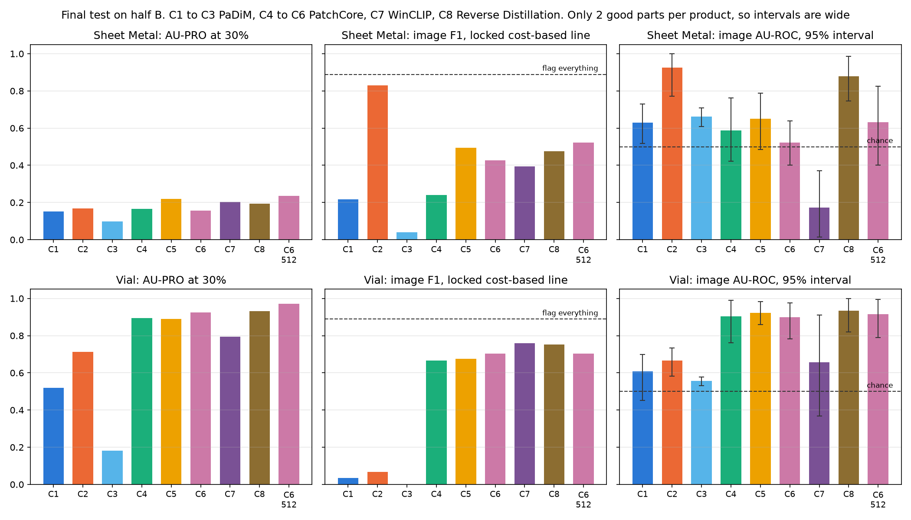
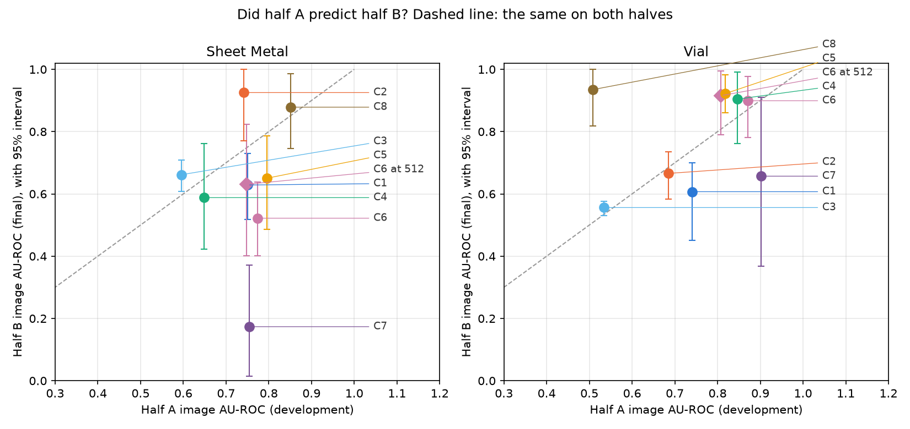
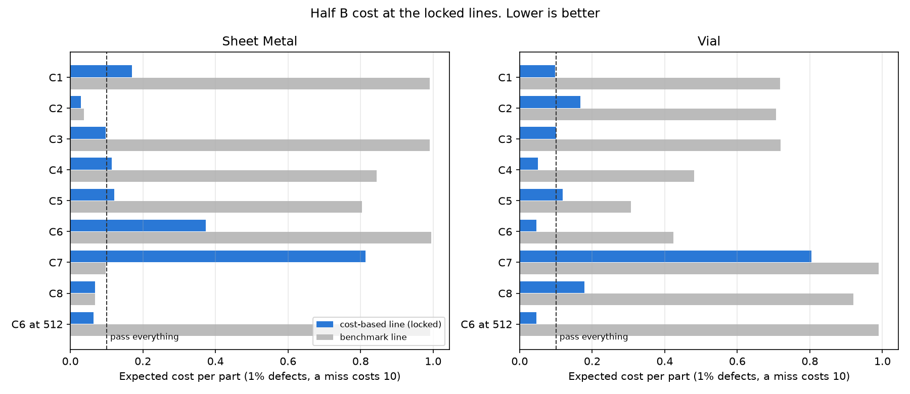
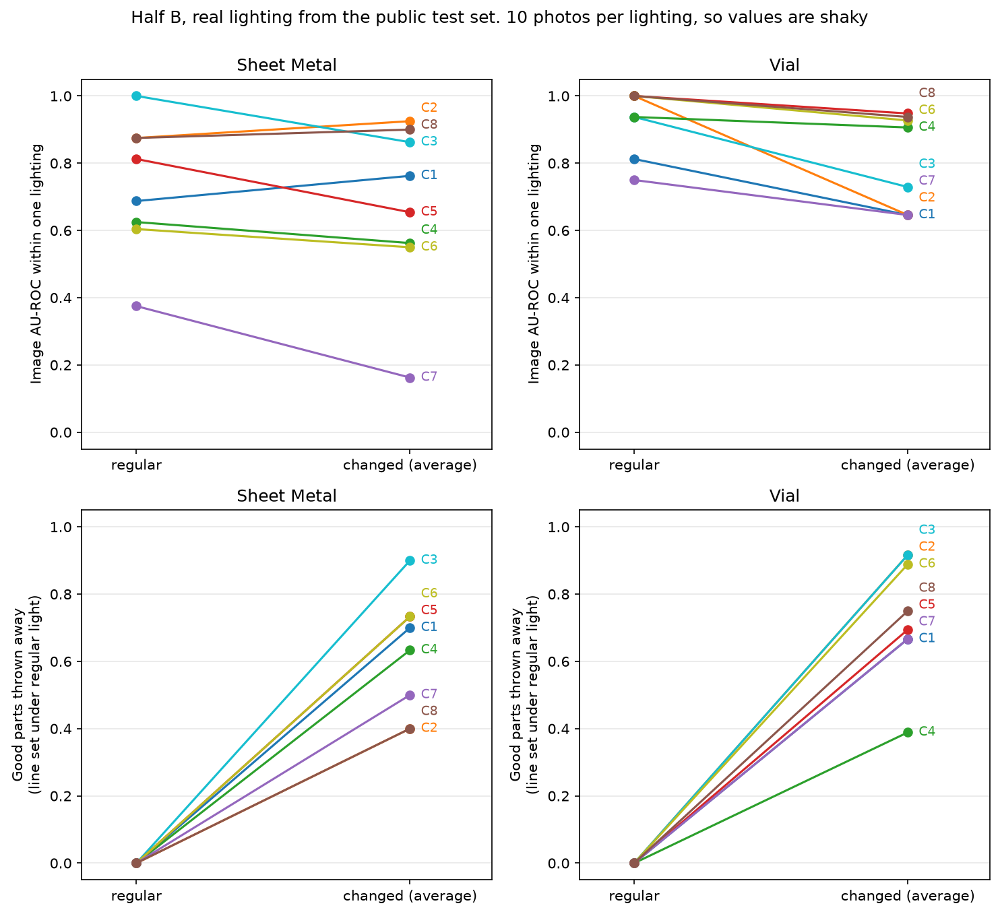

# Visual Quality Inspection with Anomaly Detection

A student case study comparing four published anomaly detection methods on two product types of the MVTec AD 2 industrial benchmark. The methods learn only from photos of good parts, then flag anything that looks different and show where it is.

## Business problem

Factories must stop defective parts before they ship. But defects are rare and unpredictable, so there are few examples to learn from. Methods that learn only from good parts avoid this problem.

Both kinds of error cost money. A missed defect reaches the customer, and a false reject throws away a good part. I assume:

- a missed defect costs 10 times a false reject, tested from 2 to 100 times;
- 1 percent of parts are defective, tested from 0.1 to 10 percent.

Real costs are not available for a benchmark. The goal is a pass or reject rule that keeps the total cost of errors low, and an honest recommendation per product type with its limits stated.

## Approach

- **Data:** Sheet Metal and Vial from MVTec AD 2. Every method learns from good training photos only. The good validation photos set the benchmark threshold.
- **Splitting the public test set:** it was split once into two halves, keeping all photos of one part together:
  - **Half A** was used for every choice that needed defect examples.
  - **Half B** stayed sealed until a Lock step had written down every setting and threshold. It was then opened once, for the reported results.
- **Methods and networks:** eight configurations, all at 256 pixels and with the same preparation:

  | | ResNet-18 | Wide ResNet-50 | EfficientNet-B0 | CLIP |
  | --- | --- | --- | --- | --- |
  | PaDiM | C1 | C2 | C3 | |
  | PatchCore (3 seeds) | C4 | C5 | C6 | |
  | Reverse Distillation (200 epochs) | | C8 | | |
  | WinCLIP (zero-shot) | | | | C7 |

  A resolution test ran C6 at 512 pixels.
- **Two thresholds per configuration:**
  - **The benchmark's rule:** the mean plus 3 standard deviations of good validation pixels.
  - **A cost-based line:** the cheapest line on half A.
- **Metrics:**
  - **Headline:** AU-PRO at 5 and 30 percent false-positive limits, pixel F1, image F1, image AU-ROC, runtime per photo and peak GPU memory.
  - **Comparisons:** bootstrap intervals that draw whole parts, and paired tests between configurations.
- **Process:** CRISP-DM, from business understanding to deployment.

## Main results (half B, the final test)

Each value is the mean over seeds. Intervals are 95 percent part bootstraps. With only 2 good parts per product in half B, they are wide. The full table, with spreads, is in [final_results_table.md](outputs/results/final_test/final_results_table.md).

| Configuration | Sheet Metal AU-ROC [interval] | Sheet Metal AU-PRO 30% | Vial AU-ROC [interval] | Vial AU-PRO 30% | Seconds per photo (Vial) |
| --- | --- | --- | --- | --- | --- |
| C1 PaDiM, ResNet-18 | 0.63 [0.52 to 0.73] | 0.15 | 0.61 [0.45 to 0.70] | 0.52 | 0.006 |
| C2 PaDiM, Wide ResNet-50 | **0.93** [0.77 to 1.0] | 0.17 | 0.67 [0.58 to 0.73] | 0.71 | 0.018 |
| C3 PaDiM, EfficientNet-B0 | 0.66 [0.61 to 0.71] | 0.10 | 0.56 [0.53 to 0.58] | 0.18 | 0.007 |
| C4 PatchCore, ResNet-18 | 0.59 [0.42 to 0.76] | 0.16 | 0.90 [0.76 to 0.99] | 0.90 | 0.017 |
| C5 PatchCore, Wide ResNet-50 | 0.65 [0.49 to 0.79] | 0.22 | 0.92 [0.86 to 0.98] | 0.89 | 0.043 |
| C6 PatchCore, EfficientNet-B0 | 0.52 [0.40 to 0.64] | 0.16 | 0.90 [0.78 to 0.98] | 0.92 | 0.013 |
| C7 WinCLIP, CLIP | 0.17 [0.01 to 0.37] | 0.20 | 0.66 [0.37 to 0.91] | 0.79 | 0.245 |
| C8 Reverse Distillation, Wide ResNet-50 | 0.88 [0.75 to 0.99] | 0.19 | **0.93** [0.82 to 1.0] | 0.93 | 0.026 |
| C6 at 512 pixels | 0.63 [0.40 to 0.82] | 0.24 | 0.92 [0.79 to 0.99] | 0.97 | 0.153 |

## Main findings

1. **Half A did not predict half B well.** The models repeated exactly: all 34 half A runs gave the same numbers again in the Final test. But the ranking of configurations changed a lot between the two halves. For example:
   - WinCLIP was the best on Vial half A (AU-ROC 0.90) and fell to 0.66 on half B.
   - Reverse Distillation rose on Vial from 0.51 on half A to 0.93 on half B.
2. **Both locked recommendations failed at their cost-based lines on half B.**
   - **C6 on Sheet Metal:** 0.37 per part, against 0.04 on half A.
   - **WinCLIP on Vial:** 0.80 per part, against 0.02.
   - Passing every part would cost 0.10. Following the Lock, the recommendations are reported as they are and not replaced.
3. **The threshold is the weak point, not only the model.**
   - Each half has only 2 or 3 good parts. A line set just above half A's good parts rejected many of half B's good parts, which look different.
   - Changed lighting adds to this: a line set under regular light throws away 39 to 92 percent of good photos under changed light, depending on the configuration.
4. **What held on both halves:**
   - PatchCore beats PaDiM on Vial.
   - Reverse Distillation ranks Sheet Metal photos well.
   - Lighting changes hurt every method.
   - Small, thin or faint defects are missed most often.
5. **Resolution:** C6 at 512 pixels made no real difference to image AU-ROC on either half. It is 7 to 12 times slower per photo.

**The full write-up:** [final_findings.md](outputs/results/final_test/final_findings.md), with the development work in [failure_causes_phase7.md](outputs/results/07_evaluation/failure_causes_phase7.md) and [resolution_findings.md](outputs/results/08_resolution/resolution_findings.md).

## Limits

- **Few photos:**
  - Each half of the public test set holds only 2 or 3 good parts per product, under 6 or 7 lightings.
  - Every interval is wide, and thresholds cannot be checked well.
- **Only part of the benchmark:**
  - Two of the eight MVTec AD 2 product types were used.
  - The private test sets were not scored. The official server needs all eight types.
  - So these results are not directly comparable with the paper's. The paper uses the private test sets, all eight types and its own image sizes; this project uses half of the public test set, 256 pixels (and 512 for one test) and three seeds for PatchCore. See also the [notes on the first run against the paper](docs/c1_repeat_and_paper_notes.md).
- **Pixel metrics are uncertain.** The defect masks were drawn by people, and their agreement cannot be measured here.
- **Defect types are not balanced.** The test files do not label defect types, so the split into halves could not balance them.

## Demo

A small Streamlit app in [app/](app/README.md) shows C6 at work on the laptop's processor. It shows the verdict, the score, the heat map and the locked line for any public test photo. It also has a mode with the saved half B results. The model files and photos are not in the repository. [app/README.md](app/README.md) explains how to get them.

## Reproducing the results

1. **Download the data:** MVTec AD 2 from the [official page](https://www.mvtec.com/research-teaching/datasets/mvtec-ad-2) (CC BY-NC-SA 4.0). It is not included here.
2. **Set up the laptop environment:** Python 3.11 with the exact versions in [requirements.txt](requirements.txt). It is used for tests, plots and the demo.
3. **Run the notebooks in [notebooks/](notebooks/) in their number order.**
   - Fitting, training and full evaluation run on Kaggle with a GPU. The Kaggle settings for each notebook are in `configs/kaggle_*`.
   - The `final_*` notebooks are the Final test.
   - The shared measuring code is in [src/](src/), with known-answer tests in `src/test_evaluate.py` and `src/test_cost.py`.
4. **Settings:** every configuration's settings, each with its reason, are in [configs/](configs/).

All reported numbers come from Kaggle. The laptop and Kaggle use different library versions (see Environments below).

## Project status

This project follows CRISP-DM, a standard process for data science projects.

| Phase | CRISP-DM stage | What it produced |
| --- | --- | --- |
| 0. Setup and business understanding | Business understanding | Repository structure, licence, laptop environment, and a notebook that ran on a Kaggle GPU ([report](outputs/results/00_gpu_check/gpu_check_report.txt)) |
| 1. Data acquisition and integrity | Data understanding | Sheet Metal and Vial confirmed, a [data card](docs/data_card.md), and integrity checks on all 1,773 images and masks ([report](outputs/results/01_data_and_integrity/integrity_report.txt)) |
| 2. Exploring the images | Data understanding | A public test [summary](outputs/results/02_exploration/test_set_summary.txt), its one split into a development half and a final half ([A](outputs/results/02_exploration/half_a_files.csv), [B](outputs/results/02_exploration/half_b_files.csv)), [defect sizes](outputs/figures/defect_size_histogram.png), [defect locations](outputs/results/02_exploration/defect_location_summary.txt), [good-part variation](outputs/results/02_exploration/good_part_variation_summary.txt), and brightness charts ([Sheet Metal](outputs/figures/brightness_comparison_sheet_metal.png), [Vial](outputs/figures/brightness_comparison_vial.png)) |
| 3. Preparing the images | Data preparation | Image size 256 for the main experiments and 512 for the resolution test, chosen from a [GPU size check](outputs/results/03_gpu_size_check/gpu_size_results.csv). Squashing chosen after a [comparison](outputs/results/03_preprocessing/shape_options.txt) of squash, pad and crop. A [diagnosis](outputs/results/03_inverse_diagnosis/inverse_results.csv) and [real-model check](outputs/results/03_padim_real_check/padim_real_results.csv) of PaDiM's statistics step. A [prepared batch check](outputs/results/03_prepared_batch/prepared_batch_check.txt), and [configuration files](configs/) C1 to C8 |
| 4. First model run | Modelling | A PaDiM baseline with ResNet-18 on Sheet Metal ([metrics](outputs/results/04_padim_baseline/c1_sheet_metal_metrics.txt)), a repeat with the same seed and a [loose comparison with the paper](docs/c1_repeat_and_paper_notes.md), and an [EfficientNet-B0 check](outputs/results/04_efficientnet_check/efficientnet_check_results.csv). These are development numbers from half of the public test set, with one seed, not final results |
| 5. Core comparison | Modelling | PaDiM and PatchCore with ResNet-18 and Wide ResNet-50 on both product types, with PatchCore over three seeds, measured by [shared code](src/evaluate.py): a [results table](outputs/results/05_core/phase5_results_table.md), a [chart](outputs/figures/phase5_metric_comparison.png) and [paired tests of differences](outputs/results/05_core/phase5_paired_differences.csv). These are development numbers from half of the public test set. Final results come from a single test on the other half, after every choice is locked |
| 6. Thresholds, costs and failures | Evaluation | The paper's [benchmark threshold](outputs/results/06_evaluation/benchmark_threshold_table.csv) compared with a cost-based line from [shared code](src/cost.py), assuming 1 percent defects and a missed defect costing 10 times a false reject: [costs](outputs/results/06_evaluation/cost_summary.csv), [score histograms](outputs/figures/phase6_score_histograms.png), [cost curves](outputs/figures/phase6_cost_curves.png), [confusion matrices](outputs/figures/phase6_confusion_matrices.png) and [how the answer changes](outputs/figures/phase6_cost_across_ranges.png) across the ranges. A [failure analysis](outputs/results/06_evaluation/failure_causes.md) of the hardest photos. All on the development half, so these costs are optimistic |
| 7. Full comparison | Modelling and evaluation | All eight configurations on half A: PaDiM and PatchCore with EfficientNet-B0, WinCLIP and Reverse Distillation added. A [results table](outputs/results/07_core/phase7_results_table.md), a [chart](outputs/figures/phase7_metric_comparison.png), [paired tests](outputs/results/07_core/phase7_paired_differences.csv), [costs](outputs/results/07_evaluation/cost_summary.csv), a [lighting breakdown](outputs/results/07_lighting/lighting_by_config.csv) with its [chart](outputs/figures/phase7_lighting_slope.png), Reverse Distillation's [training loss](outputs/figures/phase7_rd_loss_sheet_metal.png) and the [likely failure causes](outputs/results/07_evaluation/failure_causes_phase7.md). These are development numbers from half A, not final results |
| 8. Extras | Modelling and evaluation | A resolution test of C6 at 512 against 256 pixels: a [table](outputs/results/08_resolution/resolution_table.csv), [paired tests](outputs/results/08_resolution/resolution_paired_differences.csv), a [part-by-part check](outputs/results/08_resolution/resolution_by_part.csv), an [accuracy against runtime chart](outputs/figures/phase8_accuracy_vs_runtime.png) and the [findings](outputs/results/08_resolution/resolution_findings.md). [Secondary metrics](outputs/results/08_secondary/secondary_metrics_half_a.csv) for the appendix. The official evaluation server was skipped, because it needs all 8 product types. Development numbers from half A |
| Lock and Final test | Evaluation | Every setting and both lines locked on half A, then [every configuration scored once on half B](outputs/results/final_test/final_results_table.md): [findings](outputs/results/final_test/final_findings.md), [costs at the locked lines](outputs/results/final_test/final_cost_main_setting.csv), [paired tests](outputs/results/final_test/final_paired_differences.csv), [lighting](outputs/results/final_test/lighting/lighting_by_config.csv), [half A against half B](outputs/figures/final_half_a_vs_half_b_auroc.png) and [cost](outputs/figures/final_cost_at_locked_lines.png) charts. All half A numbers repeated exactly. Half B disagreed strongly with half A, and both locked recommendations failed at their lines. These are the reported results |
| 9. Product and packaging | Deployment | A [Streamlit demo](app/README.md) of C6 on the laptop's processor, with a saved-results mode; a [model card](docs/model_card.md) with a monitoring plan; a finished [data card](docs/data_card.md); this README |
| 10. Documentation and presentation | Deployment | The written report and the presentation, submitted separately to my course |

## Data

This project uses the Sheet Metal and Vial product types from [MVTec AD 2](https://www.mvtec.com/research-teaching/datasets/mvtec-ad-2), licensed under [CC BY-NC-SA 4.0](https://creativecommons.org/licenses/by-nc-sa/4.0/). See the [data card](docs/data_card.md) for what each folder holds and what the checks found, and the [model card](docs/model_card.md) for the demo configuration.

No dataset images, masks or fitted models are in this repository. Figures showing dataset photos are saved as `gallery_*` files and kept out of git. To remake them, run the notebooks with the dataset attached.

## Environments

The laptop and Kaggle use different versions of some libraries, so all reported results come from Kaggle only.

| | Used for | Python | PyTorch | anomalib | Exact versions |
| --- | --- | --- | --- | --- | --- |
| Laptop | Small tests, plots, the demo | 3.11.9 | 2.15.0 (CPU) | 2.7.0 | [requirements.txt](requirements.txt) |
| Kaggle | Fitting, training, full evaluation | 3.13.16 | 2.11.0 (GPU) | 2.7.0 | [kaggle_pip_freeze.txt](outputs/results/00_gpu_check/kaggle_pip_freeze.txt) |

## Citations and licences

**Dataset**
- L. Heckler-Kram, J.-H. Neudeck, U. Scheler, R. König and C. Steger (2026). The MVTec AD 2 Dataset: Advanced Scenarios for Unsupervised Anomaly Detection. *International Journal of Computer Vision* 134. DOI [10.1007/s11263-026-02743-0](https://doi.org/10.1007/s11263-026-02743-0). Data under CC BY-NC-SA 4.0: non-commercial use only, with credit, and shared under the same licence.

**Methods**
- PaDiM: T. Defard, A. Setkov, A. Loesch and R. Audigier (2020). PaDiM: a Patch Distribution Modeling Framework for Anomaly Detection and Localization. [arXiv:2011.08785](https://arxiv.org/abs/2011.08785).
- PatchCore: K. Roth, L. Pemula, J. Zepeda, B. Schölkopf, T. Brox and P. Gehler (2022). Towards Total Recall in Industrial Anomaly Detection. [arXiv:2106.08265](https://arxiv.org/abs/2106.08265).
- Reverse Distillation: H. Deng and X. Li (2022). Anomaly Detection via Reverse Distillation from One-Class Embedding. [arXiv:2201.10703](https://arxiv.org/abs/2201.10703).
- WinCLIP: J. Jeong, Y. Zou, T. Kim, D. Zhang, A. Ravichandran and O. Dabeer (2023). WinCLIP: Zero-/Few-Shot Anomaly Classification and Segmentation. [arXiv:2303.14814](https://arxiv.org/abs/2303.14814).

**Pretrained networks**
- ResNet: K. He, X. Zhang, S. Ren and J. Sun (2015). Deep Residual Learning for Image Recognition. [arXiv:1512.03385](https://arxiv.org/abs/1512.03385).
- Wide ResNet: S. Zagoruyko and N. Komodakis (2016). Wide Residual Networks. [arXiv:1605.07146](https://arxiv.org/abs/1605.07146).
- EfficientNet: M. Tan and Q. V. Le (2019). EfficientNet: Rethinking Model Scaling for Convolutional Neural Networks. [arXiv:1905.11946](https://arxiv.org/abs/1905.11946).
- CLIP: A. Radford et al. (2021). Learning Transferable Visual Models From Natural Language Supervision. [arXiv:2103.00020](https://arxiv.org/abs/2103.00020). WinCLIP uses the open_clip model ViT-B-16-plus-240 with LAION-400M weights (`laion400m_e31`).
- The ResNet, Wide ResNet and EfficientNet weights were pretrained on ImageNet (O. Russakovsky et al. (2015). ImageNet Large Scale Visual Recognition Challenge. [arXiv:1409.0575](https://arxiv.org/abs/1409.0575)) and loaded through timm.

**Software** (exact versions in [requirements.txt](requirements.txt))
- anomalib 2.7.0 ([Apache-2.0](https://github.com/open-edge-platform/anomalib)): S. Akcay, D. Ameln, A. Vaidya, B. Lakshmanan, N. Ahuja and U. Genc (2022). Anomalib: A Deep Learning Library for Anomaly Detection. [arXiv:2202.08341](https://arxiv.org/abs/2202.08341).
- PyTorch and torchvision (BSD-3-Clause), timm (Apache-2.0), open-clip-torch (MIT), scikit-learn (BSD-3-Clause), matplotlib (matplotlib licence, BSD-style) and Streamlit (Apache-2.0).

## AI usage

I used Claude Code, an AI coding assistant, throughout this project to explain concepts, write and test code, run notebooks on Kaggle and draft documentation. I reviewed every result and decision myself, and every choice in this project was mine. My course's AI usage declaration lists in detail what the tool was used for and when.

## Licence

The MIT licence in [LICENSE](LICENSE) covers my code only. The [MVTec AD 2 dataset](https://www.mvtec.com/research-teaching/datasets/mvtec-ad-2) has its own licence (CC BY-NC-SA 4.0) and is not included in this repository. Download it from the official page.
